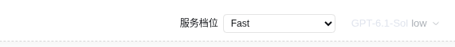
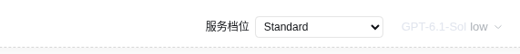

# 会话级 service_tier 验证记录

最终版本：**0.3.3-fast.1**。用户已确认设计、计划、现有功能分支交付和当前 web profile 安装。验证跨 2026-11-06 至 2026-11-07；功能代码提交为 `8b6ef87`。

## 实现与使用

- Codex 会话输入栏、模型选择附近提供 **继承默认 / Standard / Fast**，使用本会话真实 ID。
- `sessionServiceTiers` volatile 字典通过现有 ConfigEditor 持久化到 profile；原 `serviceTier` 仅作为默认。显式 Standard 不被默认 Fast 覆盖；inherit 删除仅本会话键。
- 根据 GenerateOptions.sessionId 在请求组装时读取一次：普通轮次、工具续轮、手动/自动压缩使用本会话选择；无 ID 的直接调用回退到默认。已发送请求不变。
- 不修改 DSH 核心，不把 service_tier 写入会话私有事件，不迁移 OAuth 格式。
- 本机受保护 GET/POST 接口验证已存在 live/cold 会话；冷读取使用 stat().header.id，不调用 resolveAgent。
- 非 Codex、无 ID、原生只读/寻址视图不误改默认或其他会话。分叉/子会话新 ID 独立继承默认；归档/卸载保留选择。
- 状态属于 Host/profile，不随单独会话日志导出。

## TDD 与审查

| 阶段 | RED | GREEN |
| --- | --- | --- |
| 配置与请求隔离 | 10 项旧全局行为/缺接口失败 | 定向 36/36，完整 71/71 |
| 会话 Web API | 7 项新路由缺失失败 | 定向 16/16，完整 78/78 |
| 输入栏与真实 React DOM | 9 项控件缺失失败 | 交互/渲染 16/16，完整 87/87 |
| I1 默认通知与延迟 POST 响应 | 成功/失败两条均显示旧 Standard | 完整 89/89 |
| I2 原生 namespace 注入 | namespace 约束回归失败，真实浏览器捕获异常栈 | 完整 **90/90**，最终真实浏览器相关异常为 0 |

配置测试使用真实临时文件保存/重建与实际 Cordis volatile 引用。请求测试关联并发 A/B 的 session-id 与 priority/default 请求体，并调用实际 DSH 压缩器验证 ID 传递。API 覆盖非法/重复参数、未知 ID、Host/Origin/方法、冷会话、缺编辑器、读写错误隐藏与无 Agent 启动。

前端直接运行构建 bundle、实际 React DOM/happy-dom，覆盖双窗格、重建、继承、默认变化、旧响应晚到、保存期间轮询、写失败和不可编辑 scope。

独立 reviewer 完整审查 `ca5b8b4..d724ba4`：0 Critical、1 Important、1 Minor，独立离线套件 87/87。I1 已补延迟响应成功/失败回归，写入结束后重放 invalidation 并保留错误。部署者随后从真实浏览器栈确认 I2：共享模型目录创建需要 remote/remote.session；增加声明和约束回归，最终版本升级为 fast.1。二者属于同一执行者收尾修复阶段，不开启重复审查。

**延后的 Minor M1：**旧 npm0.3.1 基线导入的 TUI 额度查询，在切 provider 时可能短暂显示旧 Codex 额度文字，至 30 秒刷新纠正；不改变模型或 service_tier 请求，本次未扩展 TUI 修改。

## 当前 GUI 的直接验证

环境：DSH 0.2.1-rc.5、Node 24.22.2、Chrome 157.0.8103.38，现有 `http://127.0.0.1:3080`；没有替代 Web 服务。

最终安装与实际浏览器均验证：

1. 当前 web profile 指向 **0.3.3-fast.1** 安装包。
2. 当前 URL 返回已安装客户端的完整有效载荷及预期 Host source-map 尾注，版本资源指纹为 `a58f11e3f726`。
3. A 会话通过实际控件保存 Fast，B 不变；B 保存 Standard，A 仍为 Fast；对应真实接口快照一致。
4. 真实页面刷新后，两个选择从服务端恢复。
5. 最终浏览器 `consoleExceptionCount: 0`；测试覆盖值已清除，4 个属于本次验证的空会话已归档。
6. 真实 HTTP 负例得到预期 400/404/405/403，无测试输入写入其他会话。

[结构化 GUI 结果](2026-11-06-session-gui.json)





### 验证夹具和覆盖边界

- 使用独立浏览器、临时 helper 与自有空会话。为不改用户默认模型，在这些夹具的发布前使用宿主支持的 model/selection 原生记录设定 Codex；service_tier 仍完全通过真实控件/ConfigEditor 保存，不写会话日志。
- 独立浏览器没有既有本地 UI 状态，遇到已安装其他插件的首次提示遮罩。只在测试页面 DOM 临时隐藏该展示层，未勾选条款、调用其后台、修改其配置或执行其构建脚本。
- 初始测试器把 Host 追加的 source-map 尾注误判为载荷差异；核对后改为严格校验完整载荷加精确尾注。浏览器退出与临时目录删除竞态也已在测试器修正。这些失败未记成产品成功。
- 初期裸 Agent 未声明 UI 模型选择，浏览器正确将其视为默认 DeepSeek；后续使用上述标准夹具验证 Codex。普通模型选择器会同时保存默认模型，因此未用它设置测试模型。
- 最终只清除本次 tier-verify 前缀的覆盖值，不从备份整体覆盖配置。较早检查确认原始模型/推理/默认档位等不变；结束时发现新的非测试会话 Fast 覆盖及默认模型变化，保留这些非测试项，不回写旧值。其余配置继续核对。

## 安装包与备份

安装包：`dsh-codex-oauth-0.3.3-fast.1.tgz`，32 个白名单普通文件；源字节一致、权限可读，无凭据、测试/执行工作区、node_modules 或本机路径混入。

```text
SHA256 fe46b4bbff14843b9c02db1bd57454dde3c6ef96d4a6ca041ade4d6ce9728dab
```

原 0.3.2-fast.1 安装和 profile 相关配置备份在本机 `codex-session-tier.Lkl6E8sf`。安装复用 pnpm11.28.11 与既有 store，显式 ignore-scripts；安装输出确认无关 dsh-purge 构建脚本被跳过。未执行 approve-builds。

## 对审查保留判断的逐项裁定

1. 不追加真实 Fast/计费探针。此前唯一获同意的 priority 请求实际返回 default；实际资格、速度、额度倍率仍未证实。
2. 安装、包审计、原生重载、GUI/API、推送、所有权由执行者直接验证，不做第二轮审查；这些操作不冒充只读 reviewer 的结论。
3. npm0.3.1 来源沿用既有 SRI/校验记录，不重复下载；若旧来源证据有误，本轮不会重建它，但导入运行时代码已被审查。
4. 不追加真实账户登录/撤销/WHAM 注册试验，保留账户状态；代码/离线回归不等于新的实账号端到端验证。
5. 不扩大为密码学、全依赖或无关宿主/插件审计；这些问题不由本轮功能结论保证。
6. 分叉/子会话不复制父覆盖、日志导出不携带字典；迁移到其他 Host/profile 需重新设置。
7. 不新增永久删除 GC 或 TUI/桌面档位控件；历史项保留，新增 UI 限定 Web。
8. 当前本机真实挂载/RPC/控件已验证，不扩大到远端/反代；loopback 边界保留，那些环境不在覆盖内。

## 其余实施裁定

- 沿用用户指定专用 clone 和功能分支，不增加嵌套 worktree；main 不改，代价是没有第二 checkout 隔离。
- 最终审查在实施完成、部署前进行；部署结果用直接证据而非重复审查确认。
- subagent 工具没有独立模型选择参数，最终审查使用可用继承模型和新上下文，不宣称独立指定了最强模型。
- 原生 DI 缺项在部署阶段才暴露，纳入同一执行者修复阶段；以 fast.1 新包身份防止旧安装/缓存混淆，不改功能范围。
- 继承已确认的“只推送 feat/fast-mode、不建 PR/不发布 npm”选择，不重复提出分支菜单。

本记录不含凭据、账户身份、浏览器登录链接或会话正文。推送与最终清理的收尾证据随交付提交记录。
